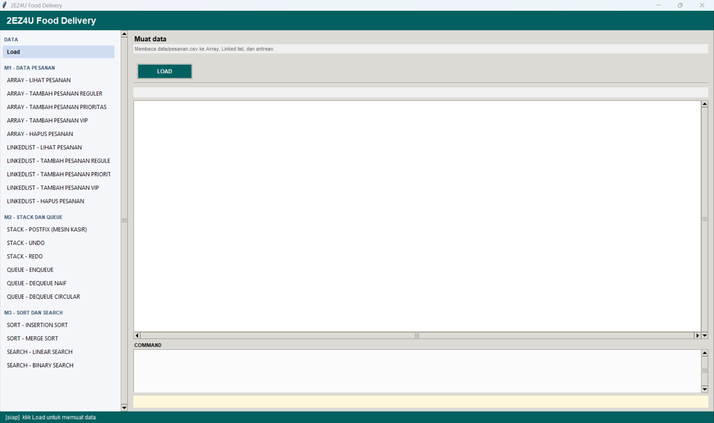

# 2EZ4U
  Aplikasi mirip gojek sederhana

## M1 : Array dan linked List
  - Membaca data dari file pesanan.csv
  - Menyimpan data dengan array dan Linkedlist
  - Menambahkan pesanan reguler, prioritas, dan VIP

## M2 : Queue dan Stack
  - Membuat antrean pesanan 
  - Memproses pesanan di antran terdepan
  - Menggunakan antrean melingkar 
  - Menggunakan undo dan redo untuk mengulangi atau pun membatalkan aksi terakhir

## M3 : Laporan, sorting dan Linear search
  - Membuat laporan pesanan
  - Mengurutkan laporan dengan sort
  - Mencari data pesanan

